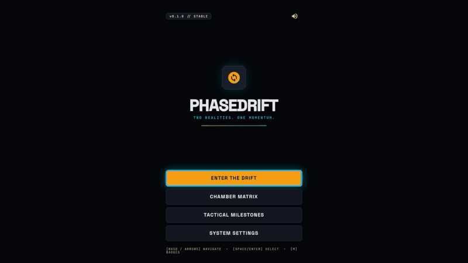

# PhaseDrift

## Two realities. One momentum.


### Gameplay



### About

```text
Invert gravity and conserve momentum across two overlapping realities.

Shift between Solar and Void dimensions at any moment to flip gravity, pass through phase-locked terrain, and chain high-speed drops into precision wall jumps and ceiling launches.

FEATURES
• Dual-Reality Physics: Solar anchors gravity downward with solid Amber blocks; Void inverts gravity upward with solid Cyan blocks.
• Conserved Momentum: Time a mid-air phase shift to slingshot velocity across gaps, spikes, and vertical shafts.
• 50 Campaign Chambers: Master 5 sectors from Solar Dawn to Grand Singularity with crisp coyote time and jump buffering.
• Quantum Drift Mode: Play endless procedural anomalies or enter integer seeds to race identical layouts.
• Chrono-Shards & Speed Ranks: Collect all 3 shards and clear under par time for S Rank, then race your holographic PB Ghost.
• Adaptive Dual-Stem Audio: Soundtrack crossfades seamlessly every time you shift realities.
```

### Controls

| Action           | Keyboard               | Gamepad                 | Touch          |
| :--------------- | :--------------------- | :---------------------- | :------------- |
| Move             | `A` / `D` or `←` / `→` | Left Stick / D-Pad      | Rocker `<` `>` |
| Jump / Wall Jump | `Space` / `W` / `↑`    | `A`                     | `JUMP`         |
| Phase Shift      | `Shift` / `E`          | `B` / `X` / `LB` / `RB` | `SHIFT`        |
| Quick Restart    | `R`                    | `Select`                | Pause Menu     |
| Pause            | `Esc` / `P`            | `Start`                 | HUD Pause      |

Settings includes **Southpaw** touch layout, button scale/opacity, **Haptics**, **Reduce Motion**, and **PB Ghost Runner** toggles.
